<p align="center">
  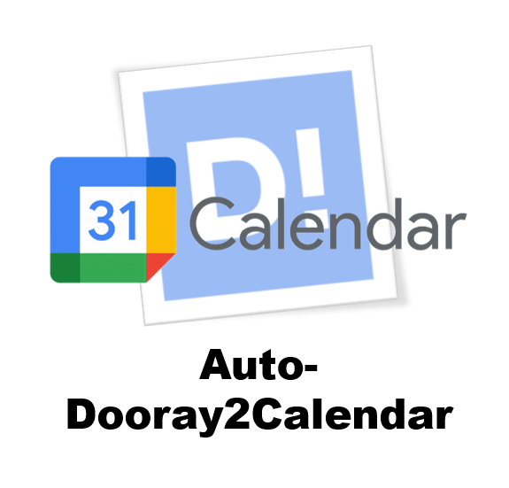
</p>

# 이게 뭔가요?
**Dooray!를 통해 날아오는 메일들을 AI를 통해 자동으로 분류하여 Google Calendar에 정리해주는 프로그램입니다.**

Dooray!에 수많은 대회나 행사 일정 메일이 오는 것을 일일이 읽고 Google Calendar에 등록하는 것이 귀찮아서 자동화를 하기 위해 만들었습니다. 학부생들을 위해 간단히 만든 프로그램이라서 기준 prompt가 대회/행사 일정을 잡는 것에 초점이 맞춰져 있으나, AI를 사용하는 만큼 다른 prompt를 사용하면 원하는 방식으로 분류가 가능하고 Gmail을 중간에 사용하기 때문에 확장도 용이합니다.

아래 사용법을 매우 상세하게 작성했으니, 읽고 그대로 적용하면 됩니다.


# 어떻게 쓰나요?

## 준비 작업

Google Calendar의 경우 여러 가지 Calendar를 분류하여 관리할 수 있습니다. Dooray!로 정리할 일정을 추가할 Calendar를 따로 만들어 관리하면 더 편리하므로 새로운 Calendar를 만들어 봅시다. 먼저 Google Calendar로 들어가서 우측 상단의 "Settings"에 들어가세요.

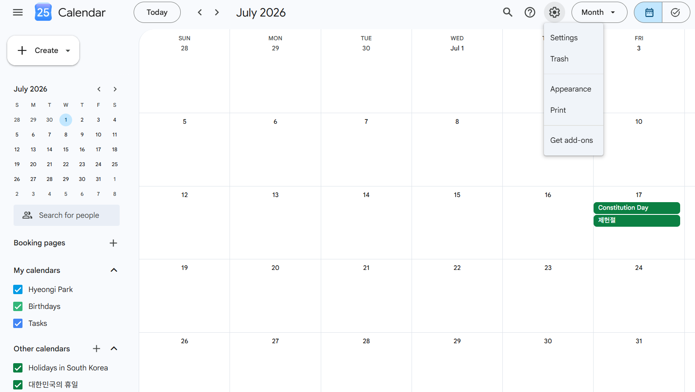

"Add calendar > Create new calendar"로 들어가 원하는 이름으로 캘린더를 만드세요. 아래 예시에서는 "Contest Schedule"이라는 이름으로 만들었습니다.

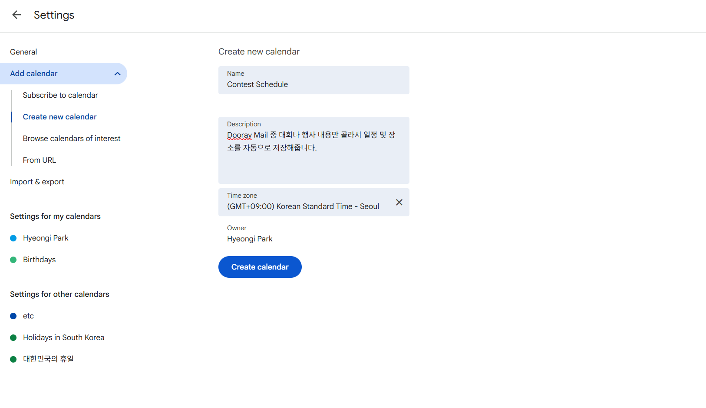

Google Apps Script를 사용하기 위해 Dooray! 메일을 Gmail로 옮기는 과정이 필요합니다. Dooray! 에서 "설정 > 메일 > 메일 전달"에서 "자동 전달 메일 주소"에 원하는 gmail 계정을 입력하세요. 

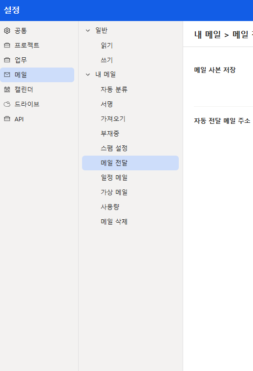

입력한 뒤에는 메일로 오는 4자리 인증 코드를 넣어야 등록이 완료됩니다. 아래 사진은 여기서는 Dooray!를 사용하는 기관 중 하나인 KAIST의 메일 주소 예시인 this_is_an_example@kaist.ac.kr 주소로 날아왔을 때를 가정한 예시입니다. 아래 코드 값(1234)이 아닌 **실제 여러분에게 날아온 인증 코드를 입력해야 합니다.** 

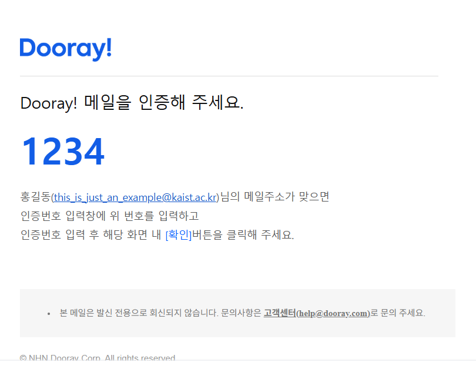

## 프로그램 설정

이제 실제로 프로그램이 돌아가게 세팅해야 합니다. 구글에 "앱스 스크립트"를 검색하세요.

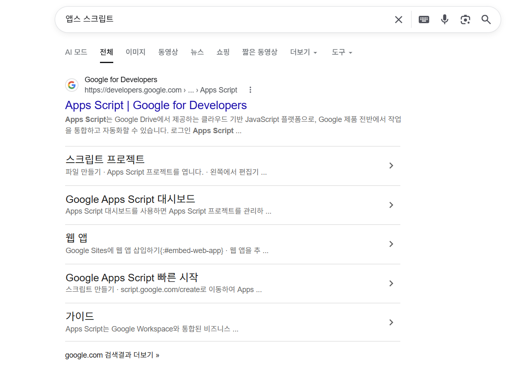

검색한 곳에 들어가서 하단의 "스크립트 시작하기"를 누르세요.

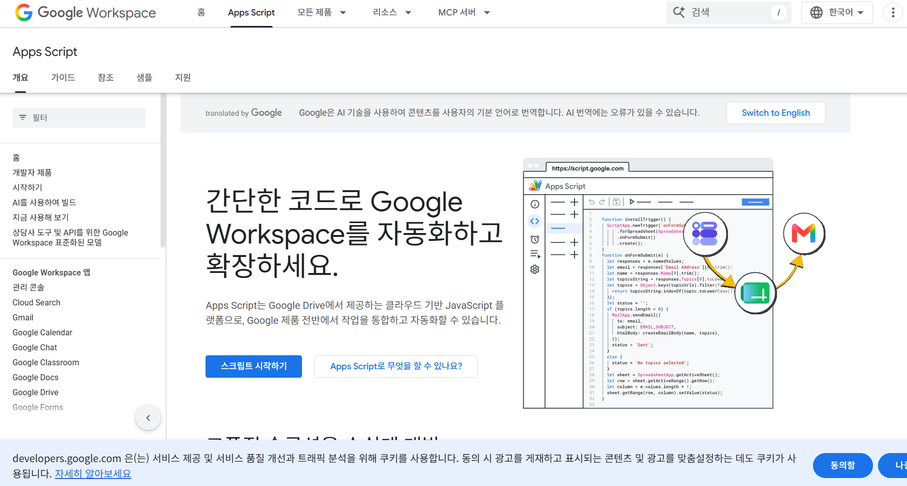

처음 들어갈 경우 위와 같은 화면이 나옵니다. "대시보드 보기"를 누르세요.

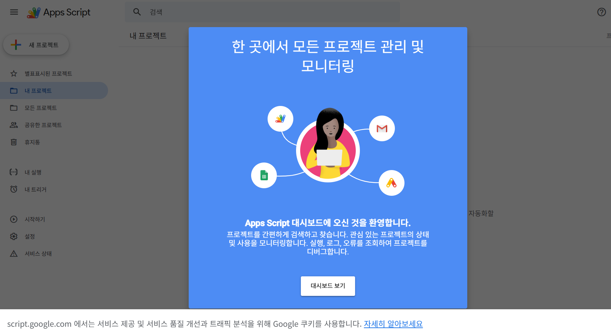

"APPS SCRIPT 만들기"를 누르세요. 

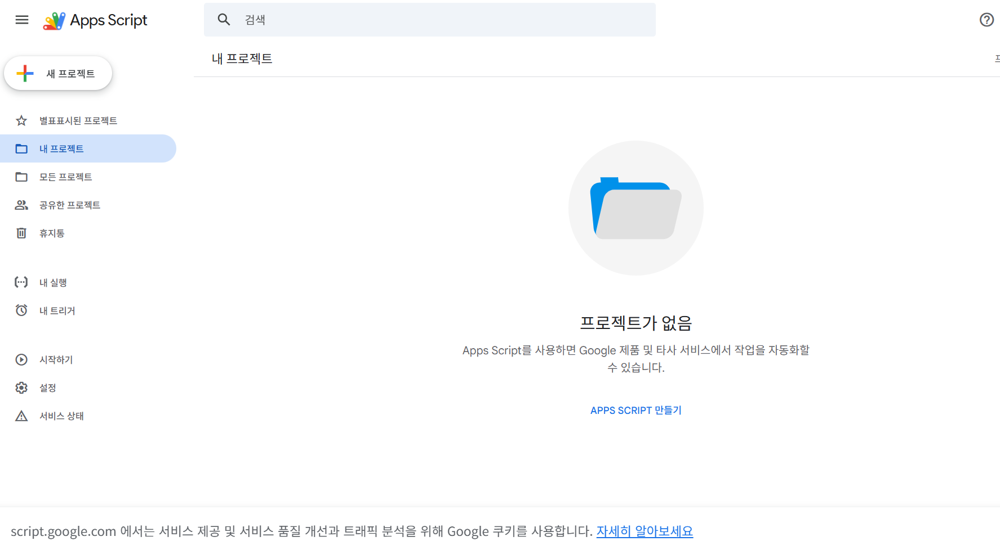

다음과 같은 화면이 나오게 됩니다.

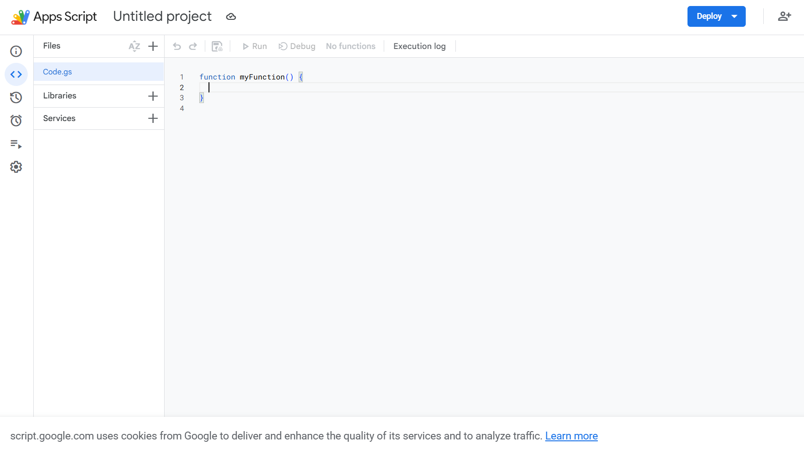

여기에 Repository 내에 있는 **Code.gs** 파일을 복사해서 붙여넣기 하세요. 코드를 붙여넣은 뒤에는 Ctrl+S를 눌러 저장을 해주어야 합니다. 프로젝트명은 아무거나 해도 상관없습니다. 이 예시에서는 "Doo2Cal"을 사용했습니다.

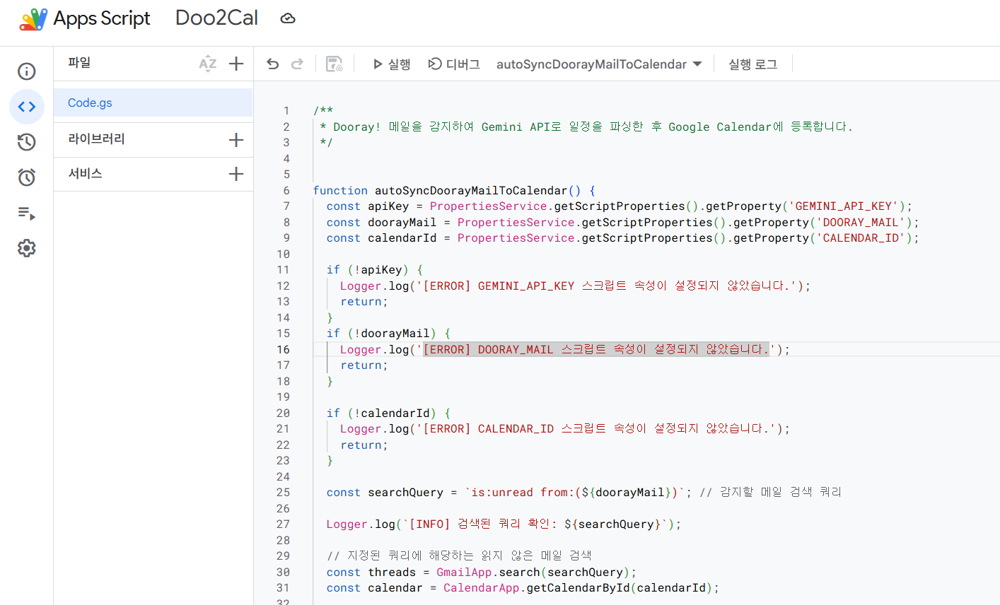

## Gemini API 키 발급

이제 메일 분류에 사용할 Gemini를 위한 Gemini APT 키를 등록해야 합니다. 구글에 "AI 스튜디오"를 검색하고 "Gemini API Keys"를 누르세요.

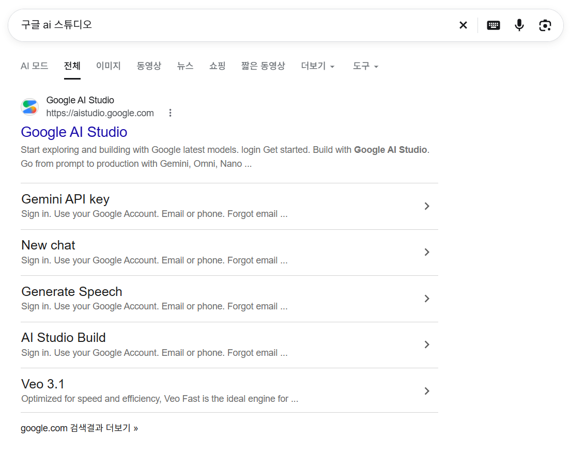

우측 상단에 "Create APT Key"를 누르세요.

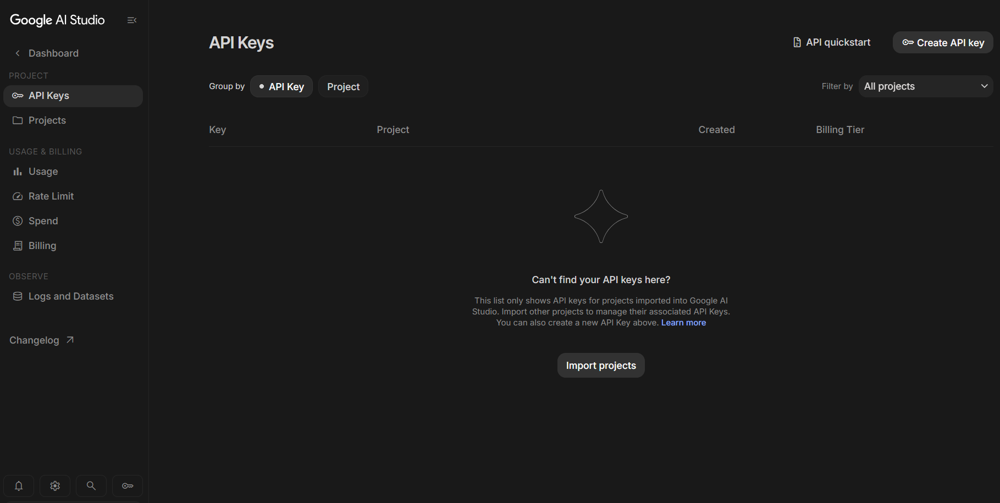

"Create Projcet"를 눌러 프로젝트를 만드세요.

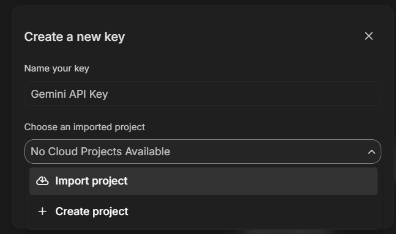

그리고 "Create key"를 눌러 API 키를 발급하세요. 이 키는 어느 누구한테도 공개해서는 안 됩니다.

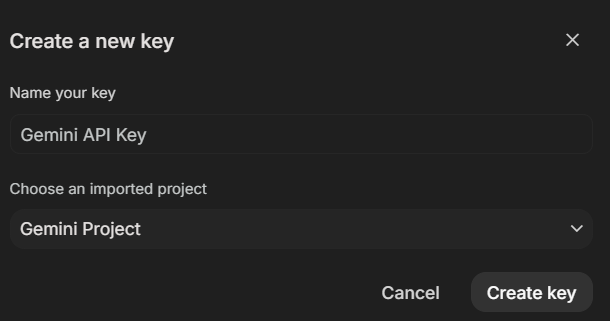

키를 복사하세요. 아래 사진에 있는 키는 임의로 적은 키이며, 실제 여러분의 화면에 나온 API 키를 사용해야 합니다.

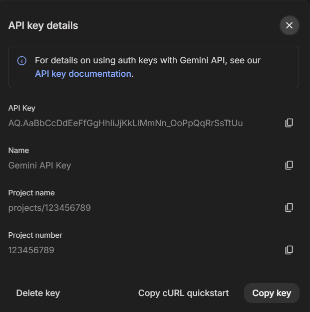

## Script Property 설정

API 키를 발급 완료했습니다. 다시 Google Apps Script로 돌아온 뒤, 우측 "Project Script"를 누르세요.

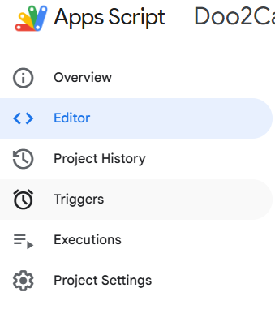

맨 아래 부분에 "Script Properties"라는 항목이 존재합니다. 거기서 "Add Script property"를 누르세요.

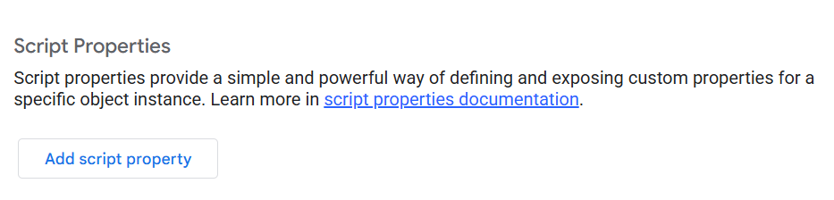

"Property" 항목에는 GEMINI_API_KEY를 "Value" 항목에는 아까 복사했던 여러분의 키를 입력하세요. Value 항목에는 아래 사진에서 나온 키 값(AQ.AaBbCcDdEeFfGgHhIiJjKkLlMmNn_OoPpQqRrSsTtUu)이 아닌, **실제 여러분이 발급한 API key를 입력해야 합니다.** 입력을 완료했으면 "Save Script Properties"를 누르세요. 

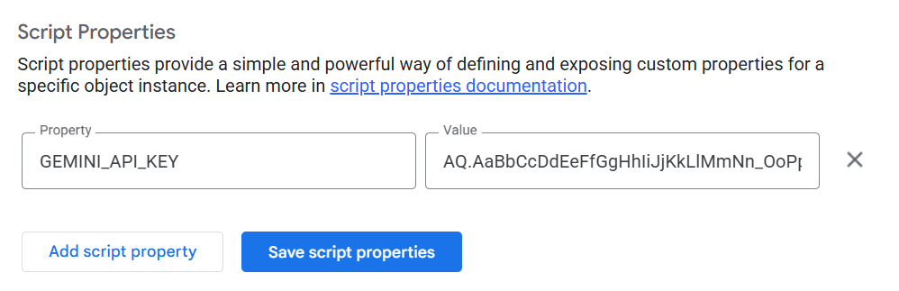

이메일 주소와 저장할 Calendar ID도 여기서 등록해야 합니다. 먼저 이메일 주소를 입력하기 위해 "Add Script property"를 눌러서 Property에는 "DOORAY_MAIL"을 입력하고 Value에는 Dooray! 메일 주소를 입력하세요. **Gmail 주소가 아니라 Dooray! 메일 주소를 입력해야 합니다.**

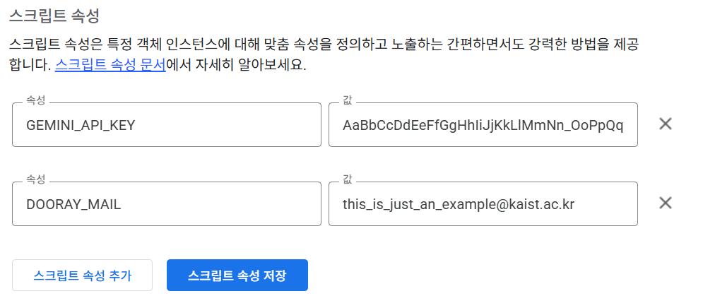

Calendar ID의 경우에는 Google Calendar의 Settings 항목에서 여러분이 이름지었던 항목을 누르고 아래로 가면 Integrate calendar 항목에 Calendar ID가 길게 적혀 있습니다. 이 값을 Value로 하고, Property는 "CALENDAR_ID"로 해서 Script Property를 더 추가하세요. Value의 경우 아래 사진에 나온 아이디 값(abcdef1234567890abcdef1234567890@group.calendar.google.com)이 아닌 **실제 여러분의 Google Calendar에 있는 Calendar ID를 입력해야 합니다.**

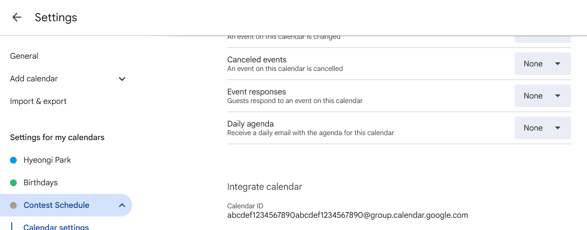

최종적으로 추가한 Script Property들은 아래 사진과 같습니다:

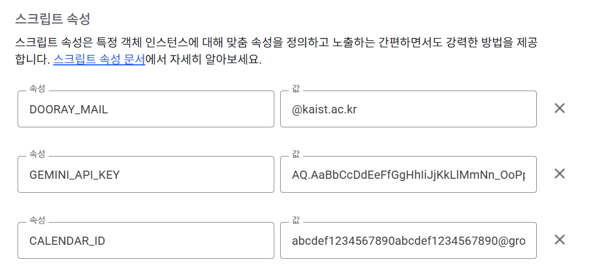

이제 좌측에 있는 "Project Setting"에서 나가 "Code"로 다시 돌아와야 합니다. 돌아온 뒤 상단의 Run을 누르세요. Run 옆에 function이 "autoSyncDoorayMailToCalendar"으로 설정되었는지 확인하세요.


## 실행 및 자동화

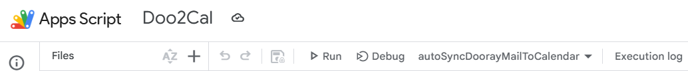

Log가 정상적으로 뜨면 잘 작동했다는 뜻입니다. 이제 자동화를 해봅시다. 자동화를 위해서는 좌측에 있는 "Code"에서 나가 "Trigger"에 들어가면 됩니다. "create a new trigger"를 누르세요.

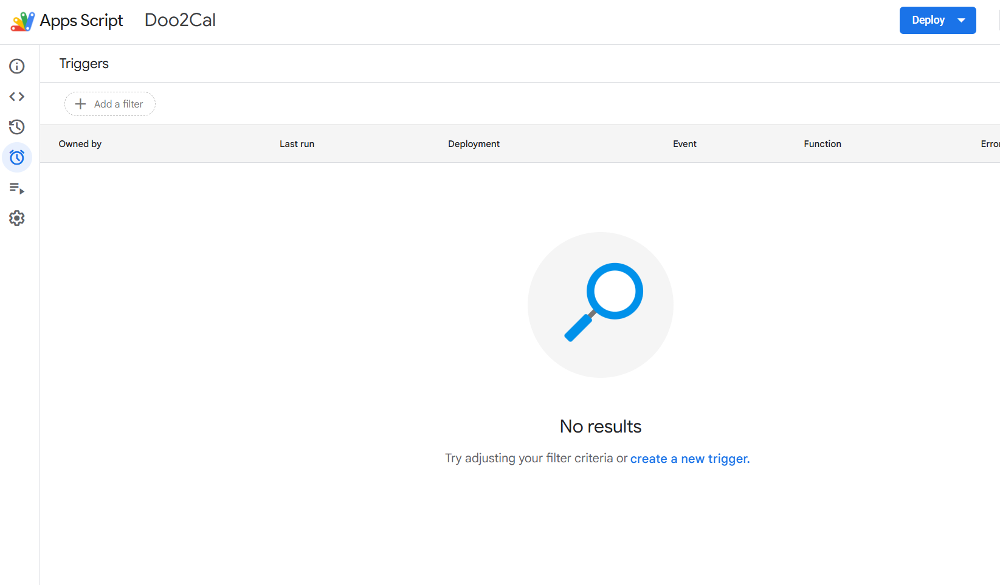

눌렀을 때 Choose which function to run이 "autoSyncDoorayMailToCalendar"으로 설정되어 있는지 확인하세요. 이후 맨 마지막에 Select hour interval에서 갱신을 위해 설정할 시간을 어떻게 할 지 지정하면 됩니다. 여기서는 "Every 8 hours"로 설정하였습니다.

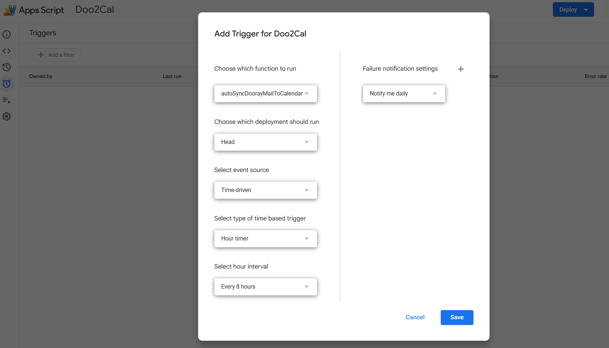

이제 등록이 완전히 끝났습니다! 휴지통에 쌓이는 메일만 잘 관리해준다면, 자동으로 Dooray!에 오는 메일 일정들을 저장할 수 있습니다.


# 어떻게 커스터마이징하나요?

이 프로젝트는 정답이 정해진 완제품이 아닙니다. 본인의 업무 스타일에 맞춰 내 마음대로 뜯어고쳐 쓸 수 있도록 만들어졌습니다. Gemini API를 사용하는 만큼, 현재 사용되는 프롬프트인 

```js
const prompt = `
당신은 메일 내용에서 행사, 대회, 세미나, 모임, 제출 마감일 등 일정 정보를 추출하고 핵심 내용을 요약하는 AI 도우미입니다.
아래 메일 내용을 분석하여 Google Calendar에 등록할 일정 정보와 상세 설명에 들어갈 요약 내용을 추출해 주세요.

[기준 메일 수신 시간]: ${todayStr}

[메일 제목]: ${subject}
[메일 본문]:
${body.substring(0, 4000)}

[핵심 추출 규칙]:
1. 메일에 특정 날짜나 일시(행사 당일, 세미나 시각, 신청/제출 마감일 등)가 단 하나라도 언급되어 있다면 적극적으로 isEvent를 true로 설정하세요.
2. 시간이 명시되지 않고 날짜만 있는 경우(예: '10월 28일 개최', '10/28 마감'), isAllDay를 true로 설정하고 시작 시간을 해당 날짜 09:00:00으로 작성하세요.
3. 한국어 날짜 표현('10월 28일(수)', '10/28', '내일', '이번주 금요일')은 [기준 메일 수신 시간]을 기준으로 연도와 날짜를 정확히 계산하세요. 연도가 생략되어 있으면 수신 시간의 연도를 적용하세요.
4. summary 필드에는 캘린더 상세 내용에 들어가기 좋도록 메일의 핵심 내용(행사 목적, 주요 안내 사항, 준비물 등)을 3~5줄 내외로 깔끔하게 요약해 주세요.
5. 순수 JSON 객체 이외의 설명이나 마크다운 백틱은 절대 포함하지 마세요.

[JSON 출력 포맷]:
{
  "isEvent": true,
  "title": "행사/대회명 (또는 '[마감] OO 신청')",
  "startDate": "YYYY-MM-DDTHH:mm:ss",
  "endDate": "YYYY-MM-DDTHH:mm:ss 또는 null",
  "isAllDay": true 또는 false,
  "location": "장소 또는 온라인 링크 (없으면 빈 문자열)",
  "summary": "메일 내용의 핵심 요약 내용 (3~5줄)"
}
`;
```
위 내용을 변경한다면 원하는 대로 사용이 가능합니다. 요약 스타일을 변경한다던지, 시간 기본값 세팅을 바꾼다던지, 특정 키워드가 들어가면 제목 앞에 무조건 \[긴급\] 같은 글자를 붙인다던지 하는 방식으로 할 수 있습니다. 또한 코드 자체는 Dooray!의 자동 전달 메일 기능을 사용해 Gmail에서만 동작하게 한 Google Apps Script 코드이므로 Gmail로 자동으로 보낼 수 있는 그 어떤 메일이든지 변환해서 사용이 가능합니다. MIT 라이선스에 따라, 코드 수정, 재배포, 상업적 사용이 가능하므로 마음대로 커스터마이징해서 사용하시면 됩니다. 이 코드도 LLM의 도움을 받아 만들어진 코드여서, LLM을 사용해 입맛대로 코드를 변경하는 것도 한 가지 방법일 수 있습니다.


# 오류가 났어요. 어떻게 해결하나요?
## '\[ERROR\] 메일 XX 파싱 또는 캘린더 등록 실패 : Unterminated string in JSON at position XX (line XX column XX)' 가 자꾸 뜹니다
위 에러는 대체로 Gemini API가 생성한 JSON 응답이 끝까지 출력하지 못하고 중간에 뚝 끊겨서 발생한 문자열 파싱 에러입니다. 현재 코드에서는 속도를 높이기 위해 `MAX_OUTPUT_TOKENS`라는 값으로 출력 토근값을 최대 `1000`으로 제한해두었습니다. 여러 이벤트들을 동시에 처리하다 보면 토큰 제한에 걸려 출력이 중단되어 JSON 형식이 따옴표나 중괄호가 닫히지 않은 형태로 나왔을 확률이 있습니다. 이 오류가 자주 발생한다면 코드 내 맨 상단의 `MAX_OUTPUT_TOKENS`값을 더 늘려주세요. 혹은 트리거를 시간 단위로 설정했을 때, 빈도를 좀 더 높여준다면 한 번에 적은 양을 처리하게 되므로 오류가 발생할 확률이 줄어듭니다. 오류가 발생할 경우 다음 트리거로 넘어갑니다.

또 다른 에러의 원인으로는 커스터마이징을 통한 프롬프트 수정 과정에서 Gemini가 적절한 JSON응답을 내놓지 못하는 경우가 있을 수 있습니다. 원하는 방식으로 커스터마이징 과정에서 꼭 `[JSON 출력 포맷]`을 명시하고 이를 출력하도록 강제성을 부여하면 이 에러가 날 확률이 줄어듭니다.


## '\[INFO\] 이전 스크립트 실행이 아직 처리 중입니다. 이번 실행은 건너뜁니다.' 가 현재 실행 중이 아닌데도 뜹니다
위 에러의 경우 Google Apps Script에서 코드 실행을 수동으로 눌렀다가  LockService.getScriptLock()가 잠겨버린 경우일 수 있습니다. 일반적으로 이 잠금은 5분에서 15분 정도 가만히 있으면 maximum execution time으로 인해 종료되는 편이지만, 바로 실행을 원한다면 코드 맨 앞에 `LockService.getScriptLock().releaseLock();`을 추가하여 실행하면 정상적으로 작동할 것입니다. 만약 이 오류가 지속적으로 발생한다면 Lock 관련 코드를 제거하여 커스터마이징하는 것도 한 가지 방법입니다. 이 경우 트리거 시간 간격을 6분 이내의 너무 빠른 시간 간격으로 할 경우 같은 메일을 두 개 이상의 스레드가 처리하여 캘린더에 같은 일정이 여러 개 생길 수 있습니다.


## '\[WARNING\] 실행 시간 제한에 도달하여 작업을 다음 실행으로 미룹니다.' 가 자꾸 뜹니다
Google Apps Script의 경우 코드의 실행 한 번에 최대 제한시간이 무료 계정 기준 `6분`으로 설정되어 있으며, 이로 인해 코드가 실행 중 중간에 끊겨 LockService가 제대로 동작하지 않을 수 있습니다. 이를 우려하여 현재 코드에서는 `MAX_EXECUTION_TIME_MS`이라는 값을 ms단위로 `4분 30초`로 설정하여 최대 동작 시간을 `6분`보다 작은 값으로 지정하여 사용 중입니다. 메일에서 처리해야 할 내용이 많고 복잡하여 시간이 오래 걸리는 상황으로 인해 위 에러가 자주 뜬다면, `MAX_OUTPUT_TIME_MS` 값을 현재 설정된 값보다 더 늘려주세요. 다만 `6분`을 넘지 않는 것을 권장합니다. 만약 `6분`을 넘겨서 설정할 시 위의 '\[INFO\] 이전 스크립트 실행이 아직 처리 중입니다. 이번 실행은 건너뜁니다.'가 실행 중이 아닌데도 뜰 수 있습니다. 이 경우 위의 에러 해결 설명을 참고하여 문제를 해결해주세요.


## Gemini API 처리 실패로 HTTP 429가 뜹니다
Gemini API의 경우 RPD(Requested Per Day)라고 해서 하루에 API를 요청할 수 있는 최대 횟수를 제한하고 있습니다. RPD 제한 외에도 TPM(Tokens Per Minutes), RPM(Requested Per Minutes) 등의 제한을 넘지 않아야 합니다. Google AI Studio의 USAGE&BILLING 항목의 Rate Limit에서 RPD, TPM, RPM 항목 중 어느 것이 초과했는지 확인 가능합니다. 아래 사진은 RPM을 초과한 상황의 예시입니다.

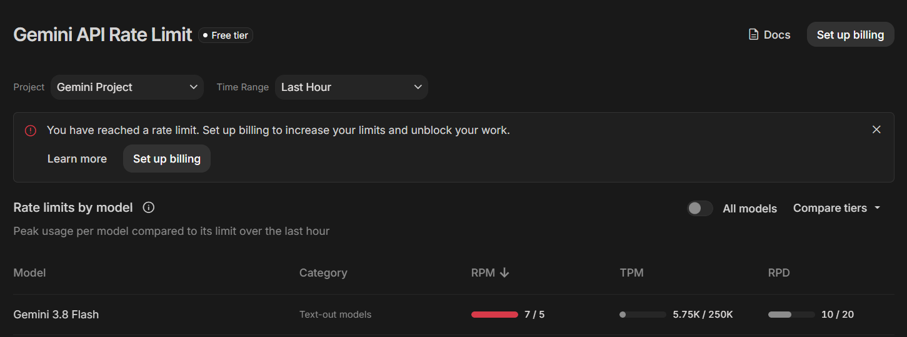

RPM 초과로 인한 에러는 보통 한 요청에 `BATCH_SIZE`를 너무 많이 주어서 그런 경우일 수 있습니다. 현재는 한 번에 처리하는 메일 수인 `BATCH_SIZE`값을 `3`으로 지정해놓았으나, 이 값을 현재 정책상 무료 Gemini API의 RPM 최댓값인 `5` 이상으로 설정한다면 문제가 발생할 수 있습니다. 따라서 `5`이하의 작은 값으로 설정하는 것을 추천합니다. 다른 해결 방식으로는,  트리거 시간 단위를 늘리는 방식으로 해결이 가능합니다. 1분 정도의 너무 짧은 시간으로 트리거를 설정한다면 이 에러가 날 수 있습니다. 현재 무료 계정의 경우 현재 정책상 gemini-3.8-flash를 하루에 최대 20번씩 요청할 수 있으므로 시간 간격을 1시간보다는 큰 시간 간격으로 설정하는 것을 권장하며, 2시간 정도의 간격을 추천합니다.

TPM 초과로 인한 에러는 RPM 초과로 인한 에러와 비슷하게 해결이 가능하지만, `MAX_OUTPUT_TOKENS` 값을 줄이는 방식으로도 어느정도 해결이 가능합니다. 현재 `1000`으로 설정되어 있는데, 만약 `BATCH_SIZE * MAX_OUTPUT_TOKENS`가 현재 무료 API TPM의 최댓값인 `250K`를 넘는다면 `MAX_OUTPUT_TOKENS`를 줄여서 성과가 있을 수 있습니다. 다만 이 경우 오히려 맨 위의 Gemini API가 생성한 JSON 응답이 끝까지 출력하지 못하고 중간에 뚝 끊겨서 생기는 에러가 날 수도 있으니 크게 권장하지 않고, `BATCH_SIZE`를 줄이는 방식을 더 권장하는 편입니다.

RPD 초과로 인한 에러는 보통 해결이 어렵습니다. 하루에 같은 종류(thread)의 처리해야 할 메일들이 20개 이상이라면 유료 플랜 구매를 고려하는 걸 추천드립니다. 혹은 커스터마이징을 통해 Gemini API가 아닌 다른 AI의 API를 사용하는 방식으로 해결할 수 있습니다. 이런 해결법은 근본적인 해결법이기 때문에 만약 HTTP 429 에러가 너무 많이 난다면 유료 플랜 구매를 고려해 보세요.


## Gemini API 처리 실패로 HTTP 503이 뜹니다
이 오류는 Gemini Server가 다른 요청들로 인해 바빠서 현재 작업을 못 한다는 뜻입니다. 현재 코드에서는 이 에러가 나올 시 여러 번 재시도를 통해 최대한 오류율을 줄이려고 하고 있지만 만약 이 오류가 너무 거슬린다면 Google 유료 플랜을 구독해서 우선순위를 앞당기거나, 다른 무료 API를 사용하는 방법이 있을 수 있습니다.

낮은 확률로 이 오류가 Server가 다른 사용자들의 요청으로 바빠서 요청을 처리 못하는 경우가 아닌, 복잡한 연산을 수행할 때 Server 응답 시간이 초과 및 부하로 인해 문제가 생기는 경우일 수 있으나, 현재 설정된 모델인 gemini-3.8-flash의 경우 Pro 모델처럼 많은 연산을 사용하지 않기 때문에 이러한 일이 일어나는 경우가 매우 적습니다. 다만, 커스터마이징을 통해 모델을 수정했을 때 이러한 오류가 발생 시 이를 검토해보는 걸 추천해드립니다.


## Gemini API 처리 실패로 HTTP 404가 뜹니다
이 오류는 Gemini 모델을 현재 지원해주고 있지 않은 모델(ex. gemini-1.5-flash 등)을 사용할 때 발생합니다. 현재 정책상 무료로 사용할 수 있는 Gemini API는 Antigravity와 gemini-3.8-flash가 있으며 여기서는 gemini-3.8-flash를 사용하는 것을 권장합니다. `url` 부분의 링크에 model이 gemini-3.8-flash로 설정되어 있는지 확인해주세요.


## Google Apps Script에서 Exceeded maximum execution time 로그가 뜹니다
Google Apps Script의 최대 실행 시간은 일반 계정 기준 `6분`을 넘지 못합니다. 많은 양을 한꺼번에 처리할 경우 Gemini API가 시간 내에 답변을 내놓지 못하면서 시간 제한으로 인해 타임아웃이 될 수 있습니다. 현재 코드에는 최대 개수 제한인 `BATCH_SIZE`라는 값으로 한번에 최대로 처리하는 메일 수를 `3`개로 제한했습니다. 제한을 줄이는 방식은 maximum execution time을 넘기지 않도록 하는 좋은 방법 중 하나입니다. 다른 방식으로는 `MAX_OUTPUT_TOKENS` 값을 줄이는 것도 방법이 될 수 있겠으나, 이 경우 JSON 형식을 Gemini가 출력하다가 잘리는 오류가 발생할 수 있으므로 `BATCH_SIZE`를 줄이는 방식을 추천합니다.

